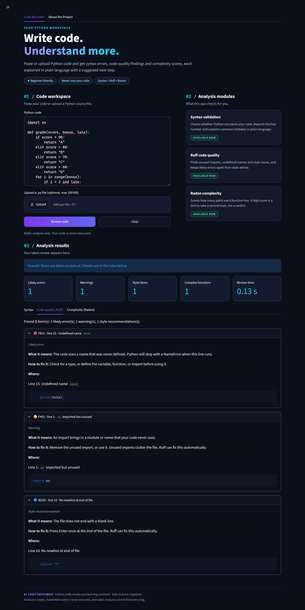

# AI-Powered Code Reviewer and Learning Assistant for Beginner Python Developers

Capstone project: Hency Babariya (48178223), Data Science Capstone.

A web app where beginners paste or upload Python code and get an automated
review: syntax errors, code-quality findings, and complexity scores, each
explained in plain language with a suggested next step.


## Current status (Sprint 1)

Working and tested:

- Paste code or upload a single `.py` file (200 KB limit, UTF-8 only)
- Uploaded-file status: shows whether the editor still matches the original file
- Clear button resets the editor, upload status, and previous results
- Syntax validation with Python's built-in `compile()`, with beginner-friendly explanations
- Code quality review with Ruff (rules E, F, W), with severity and explanations
- Complexity analysis with Radon, with explanations
- Results are tied to the exact code reviewed; edited code never shows old results
- Summary dashboard with counts of errors, warnings, style items, and complex functions

Planned (later sprints): fuller results dashboard, evaluation set and metrics,
optional LLM explanations. These are **not implemented yet**.

## Requirements

- Windows 11 (developed and tested on this), Python 3.10 or newer
- Developed with Python 3.13.9

## Setup (Windows PowerShell)

```powershell
git clone https://github.com/Hency-Babariya627/AI-Cod-Reviewer.git
cd AI-Cod-Reviewer
python -m venv venv
.\venv\Scripts\Activate.ps1
python -m pip install -r requirements.txt
```

## Run the app

```powershell
python -m streamlit run app.py
```

The app opens at http://localhost:8501.

## Run the tests

```powershell
python -m pytest -v
```

## Project structure

```
app.py                  Streamlit interface only
pipeline.py             Runs all analyzers once and bundles the results
models.py               Shared Finding format
analyzers/
    syntax_check.py     compile()-based syntax validation
    ruff_check.py       Ruff integration (subprocess, stdin)
    radon_check.py      Radon integration (Python API)
tests/                  pytest tests for each module
docs/DESIGN.md          Architecture and design decisions
```

## Security and privacy

- Submitted code is never executed. Analysis is static only.
- Ruff receives code through standard input; code is not saved to disk.
- Uploaded filenames are displayed only and never used as file paths.
- No external AI service is used, so no code leaves your machine.

## Known limitations

- Python only; one file at a time.
- Static analysis cannot find every bug or security vulnerability.
- Ruff and Radon only run when the code has valid syntax. Python reports
  only the first syntax error.
- Complexity ranks follow Radon's convention and are a guide, not a verdict.
- Explanations are rule-based templates. Rules without a template get a
  generic explanation with a pointer to the Ruff documentation.


## Screenshot
