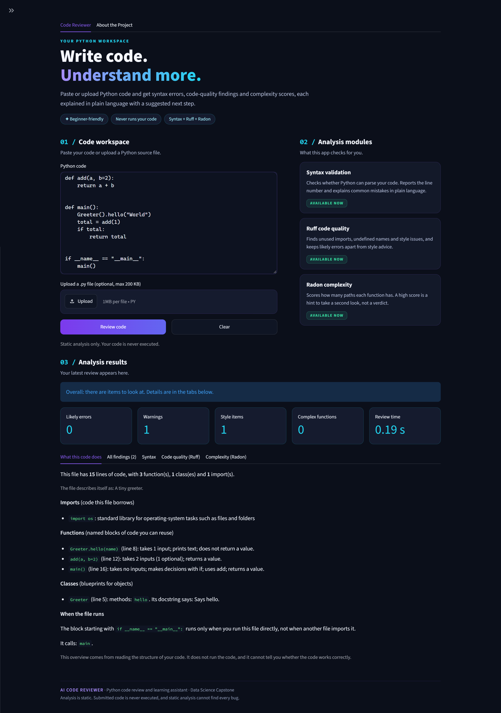

# AI-Powered Code Reviewer and Learning Assistant for Beginner Python Developers

Capstone project: Hency Babariya (48178223), Data Science Capstone.

A web app where beginners paste or upload Python code and get an automated
review: syntax errors, code-quality findings, complexity scores and a plain-language
overview of what the code is made of. Each finding comes with an explanation and a
suggested next step.

**Submitted code is never executed.** The app only parses and statically analyses the text.

**About the word "AI".** The review is rule-based: Python's own parser, Ruff, Radon and
explanation templates. No AI model is used at the moment, so no code leaves your machine.
An optional LLM layer for explanations is planned and is not required for anything above.



## Current status (updated 21 November 2026)

Working and covered by automated tests (203 tests pass):

- Paste code or upload a single `.py` file (200 KB limit, UTF-8 only)
- Uploaded-file status: shows whether the editor still matches the original file
- Clear button resets the editor, upload status and previous results
- Syntax validation with Python's built-in `compile()`, with beginner-friendly explanations
- Code quality review with Ruff (rule groups E, F, W), with severity and explanations
- Complexity analysis with Radon, flagged at a score of 6 or higher
- Explanations: rule-based templates for 27 Ruff rules and 11 kinds of syntax error, with fix
  examples for some. Other rules get a generic explanation with a pointer to the Ruff documentation.
- **What this code does:** a plain-language overview built with Python's `ast` module
  (imports, functions, classes, what runs when the file is run)
- Summary cards and tabs for the results
- Findings table with severity and source filters and a CSV download
- Results are tied to the exact code that was reviewed: edited code never shows old results

Not done yet:

- Optional LLM-written explanations (not started; the app works without it)

## Requirements

- Developed and tested on Windows 11 with Python 3.13.9 and Streamlit 1.66.1
- Python 3.12 or newer is required

## Setup (Windows PowerShell)

```powershell
git clone https://github.com/Hency-Babariya627/AI-Cod-Reviewer.git
cd AI-Cod-Reviewer
python -m venv venv
.\venv\Scripts\Activate.ps1
python -m pip install -r requirements.txt
```

## Run the app

```powershell
python -m streamlit run app.py
```

The app opens at http://localhost:8501.

## Run the tests

```powershell
python -m pytest
```

## Run the evaluation

```powershell
python evaluate.py
```

The evaluation uses 452 labelled files in `eval_data/`, in three sets: 30 short snippets,
17 files copied from two MIT-licensed public repositories (source, commit and licence are in
`eval_data/real/MANIFEST.json`) and 405 generated programs covering 25 rules, clean files,
near-miss code, syntax errors and edge cases (`eval_data/generated/DATASET_CARD.md`).
On the current version, all 362 expected findings were reported with no extra findings,
all 18 expected complexity flags matched, all 28 syntax errors were detected and none of the
109 clean files received a finding. The median time was about 90 ms per file on the
development laptop (it varies between runs).

How to read this: the scores show that the app reports what Ruff, Radon and Python report,
at the right place. They do not measure how accurate Ruff is in general. Labels come from the edit made to each file, and Ruff was used only afterwards as a cross-check. Only rules that Ruff supports are covered, and complexity has few cases.

Explanation quality: 10 explanations were rated from 1 to 3 on accuracy, clarity,
actionability and unsupported claims by two raters (sheets and results in
`docs/explanation_ratings/`). Wording for 5 rules was then rewritten and rated again;
actionability rose, the other criteria did not change clearly. Five further rules got
fix examples that were not rated.


## Project structure

```
app.py                     Streamlit interface: layout, widgets, display of results
styles.py                  CSS and fixed HTML snippets (no user text is ever put into them)
pipeline.py                Runs every analyzer once and bundles the results (ReviewResult)
models.py                  Shared Finding format
findings.py                Combines all findings into one table / CSV (no UI code)
overview.py                "What this code does" overview built with ast (no UI code)
evaluate.py                Scores the app against the labelled files in eval_data/
eval_data/                 Labelled evaluation sets (cases, real, generated) and results.json
analyzers/   
    syntax_check.py        compile()-based syntax validation
    ruff_check.py          Ruff integration (subprocess, code sent through stdin)
    radon_check.py         Radon integration (Python API)
tests/                     pytest tests for every module above
docs/   
    DESIGN.md              Architecture and design decisions
    explanation_ratings/   Rating sheets and scores for the explanation quality check
.streamlit/config.toml     Theme and upload limit
```

## How it works

1. The code is checked for syntax errors with `compile()`. This only parses the text.
2. If the syntax is valid, Ruff, Radon and the `ast` overview each run once.
3. Everything is stored in one `ReviewResult` together with the exact code it was run on.
4. The interface only displays that result. If the editor text no longer matches it,
   a warning replaces the results.

## Security and privacy

- Submitted code is never executed. Analysis is static only.
- Ruff receives code through standard input; code is not saved to disk.
- Uploaded filenames are displayed only and never used as file paths.
- Text taken from submitted code is escaped before it is shown, and the HTML in the
  interface is fixed text written for this project.
- CSV cells that start with `=`, `+`, `-` or `@` are prefixed with a quote so that a
  spreadsheet program does not treat them as formulas.
- No external AI service is used, so no code leaves your machine.

## Known limitations

- Python only; one file at a time.
- Static analysis cannot find every bug or security vulnerability.
- Ruff and Radon only run when the code has valid syntax. Python reports only the
  first syntax error, so only one is shown at a time.
- Ruff rules are limited to groups E, F and W. Rules without an explanation template
  get a generic explanation with a pointer to the Ruff documentation.
- Complexity ranks follow Radon's convention and are a guide, not a verdict.
- The overview describes structure, not correctness. Its "uses" notes follow only
  functions defined in the same file, not class methods.
- Explanations are rule-based templates, not written for each submission.
- Syntax-error explanations cover 11 common kinds; rarer errors get a generic explanation.
- Only 10 of the 27 rule explanations were rated, by two raters, so the quality check is small.
- The evaluation data is short; it is not a sample of real student code.